## Hi, I'm Yicheng 👋

Currently exploring AI infrastructure for large language models and multimodal models.

### 🛠️ Skills & Tools

<a href="https://skillicons.dev">
  <picture>
    <source media="(prefers-color-scheme: dark)" srcset="https://skillicons.dev/icons?i=cpp%2Cpy%2Cbash%2Cpytorch%2Csklearn%2Canaconda%2Cmd%2Cdocker%2Clinux%2Cvim%2Cgit%2Cgithub%2Cprometheus%2Cgrafana&amp;theme=dark">
    <source media="(prefers-color-scheme: light)" srcset="https://skillicons.dev/icons?i=cpp%2Cpy%2Cbash%2Cpytorch%2Csklearn%2Canaconda%2Cmd%2Cdocker%2Clinux%2Cvim%2Cgit%2Cgithub%2Cprometheus%2Cgrafana&amp;theme=light">
    
  </picture>
</a>

### 👾 My Contribution Graph

<picture>
  <source media="(prefers-color-scheme: dark)" srcset="https://raw.githubusercontent.com/yichengsu/yichengsu/output/pacman-contribution-graph-dark.svg">
  <source media="(prefers-color-scheme: light)" srcset="https://raw.githubusercontent.com/yichengsu/yichengsu/output/pacman-contribution-graph.svg">
  
</picture>
